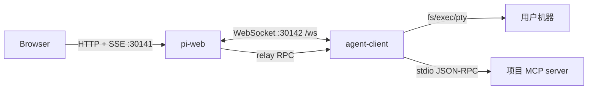

# Agent Client 与本机模式

> 状态：现行（2026-11-23，Agent Client 0.8.0）。本文是 Agent Client 的框架级文档；
> 源码/构建细节在 `agent/`，GUI 在 `agent/gui/`，本机模式会话模型见
> [multi-user-and-modes-design.md](./multi-user-and-modes-design.md)。

## 1. 定位

Agent Client 是运行在用户机器上的 Go 静态二进制，通过外连 WebSocket 把用户本机能力
提供给 pi-web：

- 文件：list/read/write/stat/mkdir/delete/rename/manifest
- 搜索：grep/fd
- 命令：exec.run / exec.stream（argv，无 shell 注入面）
- 终端：PTY create/input/resize/close
- MCP：托管 local-machine 项目的 workspace stdio server（0.8.0+）

Agent 只主动外连，不需要公网入口/端口映射；pi-web 不保存用户工作区副本。

## 2. 架构



- 浏览器完全不直连 Agent。
- WebSocket 由 pi-web 的 `instrumentation.ts` 启动的独立 HTTP server 承载（默认 30142）。
- 同一进程的 `globalThis.__piRelayRegistry` 保存配对码、Agent 连接、用户/机器映射。
- 一个用户可配对多台机器；项目绑定 `machineId`，会话按项目选择 Agent。

## 3. 配对与连接

1. 浏览器 `POST /api/agent-relay/pair` 得到一次性配对码（5 分钟）。
2. 页面展示安装/配对命令：
   `agent-client pair --code <CODE> --server <URL>`。
3. Agent 调 `POST /pair/exchange` 换 32 字节 token，写
   `~/.agent-client/config.json`（0600；旧 `~/.pi-agent` 兼容）。
4. Agent 连 `ws://<server>:30142/ws?token=...`，发 `hello`：
   `hostname/os/arch/workspaceRoot/agentVersion/machineId/label/features`。
5. 服务端要求最低客户端版本（`lib/client-compat.ts`）；过低在配对/运行时报错。
6. 同一 `machineId` 已有活连接时返回 `409`；`--replace` 可显式替换。
   Agent 0.5+ 支持多服务端 profiles（`run --server`）。

配对码绑定发起用户；token 服务端记录归属，重连自动归位。

## 4. 多机器

- `machines` 列表按 `(userId, machineId)` 多活；项目保存 `machineId`。
- 未指定机器的旧项目/旧会话使用该用户最近连接/默认机器。
- 前端机器选择器只在多机器时显示；单机器仍可显式选择。
- Agent 断线期间会话保留 descriptor；恢复时给出明确的离线/升级错误，不静默换机器。

## 5. 工作区围栏

Agent 启动时确定共享根（优先级）：

1. `--root PATH`
2. 启动目录（若是项目目录）
3. 保存的 root
4. 用户 home

每个 RPC 可带绝对 `base`（feature `workspace-base`）：

- 相对路径按 `base` 解析；
- `..`、绝对逃逸、symlink 逃逸都拒绝；
- 旧 Agent 只能访问共享根内目录，服务端自动使用根相对前缀；根外目录报错并提示升级。

`fs.manifest`（`projection-v1`）一次返回多根目录的 stat 清单，用于工作区投影快路径；
截断/失败时调用方回退逐文件 stat，绝不依据不完整清单删除。

## 6. MCP host（0.8.0+）

feature `mcp-relay-v1`；RPC：

| 方法 | 作用 |
|---|---|
| `mcp.listTools` | 启动/复用 MCP 进程，initialize + tools/list（支持 cursor 分页） |
| `mcp.callTool` | 发送 tools/call，按 JSON-RPC id 关联结果 |
| `mcp.close` | 终止该 `serverKey` 的进程 |

进程管理：

- 每个 `serverKey` 一个常驻 stdio 进程；按行 JSON-RPC；
- initialize/notifications/initialized；忽略通知，不支持服务端反向请求；
- stderr 环形缓冲（16KiB）；会话结束由 pi-web 发 close；
- 环境变量白名单：PATH/HOME/LANG/LC_* 等 + 条目 `env`；不透传 `PI_*`/relay token；
- cwd 通过 workspace base 解析，限制在项目工作区。

配置侧要求：project scope、stdio、`piWeb.plane="workspace"`、
`lifecycle=lazy`（或 lazy-keep-alive）、`directTools=false`。详见 [mcp.md](./mcp.md)。

## 7. 协议

### 7.1 消息

- 请求：`{id, method, params}`
- 响应：`{id, ok, result?, error?}`
- 流：`{id, type:"chunk", data}` → `{id, type:"end", ok, result?, error?}`
- hello：`{type:"hello", info}`

### 7.2 RPC 方法

| 类别 | 方法 |
|---|---|
| workspace | `workspace.info` |
| fs | `fs.list` `fs.manifest` `fs.read` `fs.write` `fs.stat` `fs.mkdir` `fs.delete` `fs.rename` |
| search | `search.grep` `search.fd` |
| exec | `exec.run` `exec.stream` |
| pty | `pty.create` `pty.input` `pty.resize` `pty.close` |
| mcp | `mcp.listTools` `mcp.callTool` `mcp.close` |

`fs.read` 支持 `encoding:"base64"`；`fs.write` 支持 `contentBase64`（binary-read/write）。
PTY 输出以 event 帧推送；Windows build 的 PTY 目前是桩，终端不可用。

## 8. features 与版本

| feature | 版本 | 作用 |
|---|---|---|
| `workspace-base` | 0.2.0 | 每请求绝对 base |
| `binary-read` | 0.2.x | base64 读 |
| `binary-write` | 0.6.0 | base64 写 |
| `projection-v1` | 0.7.0 | `fs.manifest` |
| `mcp-relay-v1` | 0.8.0 | MCP host |

服务端最低版本由 `lib/client-compat.ts` 控制；新功能按 feature 协商，旧 Agent 缺失时
显式降级/报错，不静默回落到服务器本地执行。

## 9. 构建与发布

```bash
cd agent
export GOPROXY=https://goproxy.cn,direct
./scripts/build.sh
```

产物：

```
dist/agent-client-linux-amd64
dist/agent-client-linux-arm64
dist/agent-client-darwin-amd64
dist/agent-client-darwin-arm64
dist/agent-client-windows-amd64.exe
```

CGO 关闭，Linux 静态链接可在 CentOS 7（glibc 2.17）运行。下载路由从
`agent/dist/` 下发，`install.sh` 负责 chmod/安装；旧 `pi-agent-*` URL 作为别名。

Agent GUI（MyGo）在 `agent/gui/`，包名 `agent-client-gui`，独立打包 tar.gz/deb；
不使用 pi 品牌/logo。

## 10. 部署

- **LAN**：pi-web `:30141`，relay `:30142`；Agent 用 `http://<host>:30142` 配对。
- **反向代理/TLS**：需同时转发 WebUI 与 relay（WebSocket Upgrade）；设置
  `PI_RELAY_ADVERTISE_URL=https://ide.example.com/relay` 生成正确配对命令。
- **主机名优先级**：`PI_RELAY_ADVERTISE_URL` > 管理员「全局配置 → 对外访问地址」的
  主机名 + relay 端口 > 浏览器当前地址 + relay 端口。
- **systemd**：`ExecStart=/path/agent-client run`，`Restart=on-failure`；
  `run` 在 TTY 下进入交互菜单，非 TTY 使用保存的连接。
- Agent 与 OS 架构不匹配会直接报错；Windows 终端功能受限。

## 11. 安全

- 配对码单次、5 分钟；token 0600；服务端撤销/解绑立即生效。
- WS 建连校验 token；非法关闭。
- 工作区 root/base 围栏（含 symlink）；`exec.run` 仅 argv。
- MCP host 使用环境变量白名单；MCP 进程仍是用户代码，用户必须信任项目配置。
- 浏览器不接触 Agent token；所有 relay 路由通过 WebUI 身份/会话归属校验。
- Agent 以用户权限运行，用户机器上的 OS 权限是最终边界。

## 12. 故障排查

| 症状 | 检查 |
|---|---|
| 配对失败/426 | 客户端版本、下载地址、`--server` 是否指向 relay 端口 |
| 连接 409 | 同 machineId 已有活进程；`--replace` 或停止旧进程 |
| 项目工作区不可用 | 项目 workdir 是否在 Agent 共享根；旧 Agent 升级到 0.2+ |
| 终端黑屏 | Linux/macOS PTY；Windows 为桩；检查 relay/平台 PTY |
| 文件 stat 双拼 | 旧版本路径映射；升级 Agent/服务端 |
| MCP 工具缺失 | Agent ≥0.8、feature `mcp-relay-v1`、project scope、plane/lazy/directTools |
| 本机写入被拒 | 路径护栏是否批准；Agent base 是否包含目标；旧 Agent 不支持放宽 |

## 13. 相关源码

- `agent/main.go`、`agent/internal/agent/`
- `agent/internal/workspace/`（fs/exec/search）
- `agent/internal/mcp/`（0.8+ MCP host）
- `lib/relay/`（registry/forward/ws-server）
- `lib/extensions/relay-tools.ts`、`lib/extensions/remote-mcp.ts`
- `app/api/agent-relay/**`
