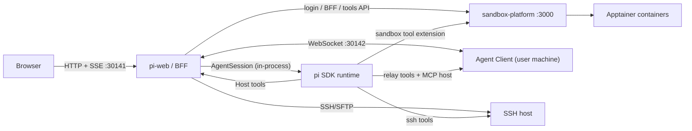
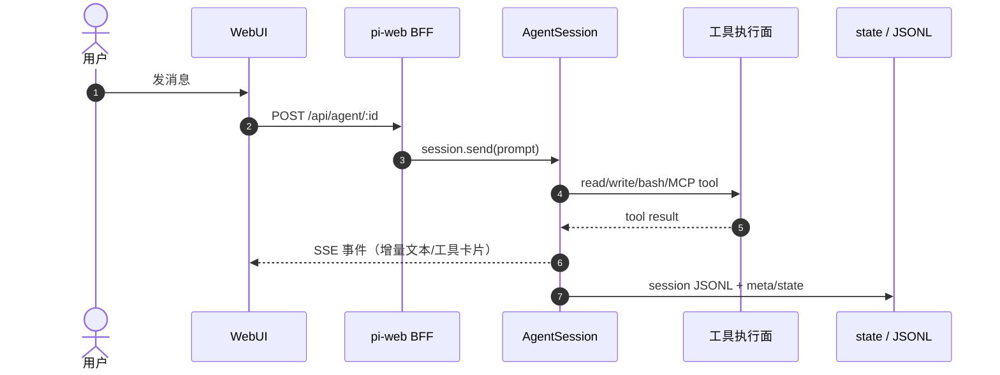

# 平台总体设计（架构 · 执行面 · 数据流）

> 状态：现行（2026-11-23）。本文是框架级单一入口；细节分别见
> [执行模式](./multi-user-and-modes-design.md)、[会话/项目模型](./session-project-model.md)、
> [配置层](./configuration.md)、[安全模型](./security.md)、[部署](./DEPLOYMENT.md)。

## 1. 产品与组件

pi-web 是**中心化、多用户的 Agent 智能体平台**：用户在浏览器里创建项目和会话，
Agent 进程由平台托管，工具按项目/会话的执行模式落到沙盒容器、用户自己的机器、
SSH 主机或 pi-web 服务器本地。平台同时提供配置分层、工作区投影、MCP、Agent Builder、
批量 API、嵌入页和可观测性。

| 组件 | 角色 | 技术/位置 |
|---|---|---|
| **pi-web** | WebUI + BFF + 会话控制面 | Next.js 16，本仓库 |
| **Agent runtime** | 每个会话一个 `AgentSession`，pi SDK 在 pi-web 进程内 | `lib/rpc-manager.ts` |
| **Sandbox Platform** | 用户/API key、配额、容器、workspace、快照、PTY、容器工具 API | 独立仓库 `AgentSandbox/sandbox-platform` |
| **Agent Client** | 用户机器上的 Go relay，执行 fs/exec/pty/MCP host | 本仓库 `agent/`，0.8.0 |
| **配置投影/同步** | 项目 `.pi` 与远端工作区之间的单向投影、手动同步 | `lib/projection/`、`lib/workspace-config-sync.ts` |
| **MCP host** | HTTP MCP 由 adapter 连接；local-machine 的 workspace stdio 由 Agent 托管 | `lib/extensions/remote-mcp.ts`、`agent/internal/mcp` |

关系：

三个独立边界：

1. **浏览器 ↔ pi-web**：浏览器只拿 WebUI 会话 cookie，不接触平台令牌或 Agent token。
2. **pi-web ↔ 执行面**：sandbox 走平台 API；local-machine 走 relay；SSH 走 ssh2；
   Host 直接在服务器执行。
3. **pi-web ↔ 配置/状态**：`.pi` 是项目配置，SessionDescriptor/ProjectRecord/state
   是平台元数据，会话 JSONL 是不可变历史。

## 2. 端口与数据布局

| 端口 | 服务 |
|---|---|
| `30141` | pi-web WebUI + API + SSE |
| `30142` | Agent relay WebSocket（`PI_RELAY_PORT`） |
| `3000` | sandbox-platform REST/PTY（可由反向代理隐藏） |

数据分三类：

- **会话正文**：pi agent 目录下的 JSONL（用户分片或 Host 空间），append-only。
- **平台元数据**：`<dataDir>/state/global|users|projects/*.json`，统一
  `{schemaVersion,data}` 信封、原子写、`.bak`、`proper-lockfile`。
- **大对象/工作区**：项目 home、容器 `/workspace`、附件、图片、bundle/apkg、
  workspace homes；不进入 JSON 状态库。

项目 home 中的 `.pi/` 是 SDK/adapter 直接读取的项目配置；用户 JSON 配置在
`state/users/u<id>/`（详见 [configuration.md](./configuration.md)）。

## 3. 会话与项目的两条正交轴

`SessionDescriptor` 把旧 `mode` 拆成四个轴（`lib/session-descriptor.ts`）：

| 轴 | 取值 | 含义 |
|---|---|---|
| management | `webui` / `cli` | 会话是否由 WebUI 创建 |
| execution | `local` / `sandbox` / `relay` / `ssh` | 工具实际在哪执行 |
| workspace | `managed-home` / `external-dir` / `scratch` | 工作区归属 |
| profile | `quick` | 快速会话（无用户工作区） |

项目形态：

| 形态 | ProjectRecord | execution | workspace | 说明 |
|---|---|---|---|---|
| 沙盒项目 | 有 | `sandbox` | `managed-home` | 工具进平台容器 |
| 本机项目 | 有 | `relay` | `managed-home` | 工具到配对机器 |
| SSH 项目 | 有 | `ssh` | `managed-home` | 工具到 SSH 主机 |
| WebUI Host 项目 | 有 | `local` | `external-dir` | 管理员选服务器已有目录 |
| CLI Host 会话 | 无 | `local` | `external-dir` | 只出现在 Host(CLI) |
| Quick 项目 | 有 | `local` | `scratch` | 每 `(owner,template)` 一个稳定项目 |

非 Host 会话缺项目/凭据/描述符时**失败关闭**，禁止回落到服务器本地工具。

## 4. 一次会话的数据流

要点：

- 会话注册表（运行时）优先，`session-metas`（持久 sidecar）补齐重启后的归属；
  跨用户访问统一 404。
- 工具层按 descriptor 装配：sandbox 注入容器工具；local 注入 relay 工具 +
  remote MCP；SSH 注入 ssh 工具；Host 使用本地工具。
- 文件面板/终端/Plan 与工具使用同一执行模式，不通过浏览器直连平台或 Agent。
- 会话 fork/branch/clone 复制 descriptor；恢复、子智能体、批量任务走同一
  fail-closed 恢复路径。

## 5. 执行面

### 5.1 沙盒

- 项目 home 保存 `.pi/sandbox-platform.json`（url/apiKey/containerId）。
- 会话注入 amedac-core 的 sandbox tools（原 `pi-sandbox-extension` 已合并）；
  bash/read/write/edit/grep/find/ls 经平台 `/tools/*` 进入容器 `/workspace`。
- 平台负责容器生命周期、配额、镜像白名单、workspace/快照、PTY、审计。
- 远端终端由平台 PTY WebSocket 承载；WebUI 只做 SSE 代理。

### 5.2 本机（local-machine / relay）

- 用户在设置里配对 Agent；同一用户可有多台机器，项目绑定 `machineId`。
- Agent 主动外连 `:30142`，工具请求带项目 workspace `base`；Agent 0.2+ 支持任意
  绝对工作区，旧 Agent 回落到共享根前缀。
- 平台不保存用户工作区副本；文件和命令在用户机器执行。
- 0.8.0 起 Agent 可托管项目 `.pi/mcp.json` 中声明
  `piWeb.plane="workspace"` 的 stdio MCP，详见 [mcp.md](./mcp.md)。

### 5.3 SSH

- 项目 `.pi/ssh.json` 保存凭据（0600，不进配置包）。
- 会话工具走 ssh2：SFTP 文件、exec 命令、PTY 终端；工作区根是项目 `workdir`。
- 会话 cwd 仍是服务器项目 home；远端路径只进工具/提示词映射。

### 5.4 Host / Quick

- **WebUI Host 项目**：管理员选择服务器已有目录；会话工具在服务器执行；删除项目
  不删外部目录。
- **CLI Host 会话**：CLI 创建、无 ProjectRecord，归 Host(CLI) 页面。
- **Quick**：无用户工作区，使用 per-session scratch；模板固定系统提示词/模型/MCP
  白名单，不参与项目配置包。

## 6. 配置、投影与 MCP

- 配置三层：Global（管理员默认）< User（用户 diff）< Project（`.pi`）。
- 项目 `.pi` 是 SDK/adapter 的直接输入；远端工作区通过 projection 单向获得副本，
  用户也可显式执行“工作区 → 项目”配置同步（带 schema/工具模式/信任闸门）。
- MCP 四种作用域：project / quick / user / global；项目级同名条目优先。
- 普通用户的项目 stdio MCP 默认禁止在控制面执行；local-machine +
  `plane="workspace"` 由 Agent 托管。HTTP MCP 始终由 pi-web 发起请求。
- 模型配置/凭据按 Global→User→Project 合并；项目可覆盖模型运行时。

## 7. 安全与信任

| 边界 | 机制 |
|---|---|
| Web 登录 | 平台账号代理登录，HttpOnly cookie；BFF 持平台 token |
| 会话归属 | 运行时 registry + 空间路径围栏 + owner 检查；404 不泄露存在性 |
| 路径 | path-guard（read/write/bash）+ 项目 `.pi/` 决策文件；MCP 内部路径由服务端负责 |
| 本机 | Agent workspace base + `..`/symlink 围栏；path-guard 批准可单次放宽 |
| 沙盒/SSH | 容器/SSH 权限边界；项目工作区根 |
| 宿主执行 | Host 仅管理员；普通用户 stdio MCP 禁止；MCP plane 显式声明 |
| 配置包 | 凭证剥离、路径白名单、项目信任、stdio 闸门 |
| MCP | 远端模式默认剔除未声明 stdio；relay host 强制 lazy/directTools=false |

详见 [security.md](./security.md)。

## 8. 可观测性与交付

- OTLP/HTTP 追踪：GenAI span、prompt/output/tool、session/user 标识；默认
  `localhost:8087`，支持任意 headers（MLflow `x-mlflow-experiment-id`）。
- 批量任务 API：host/sandbox/local-machine 三模式，SSE、归属隔离、每用户并发限流。
- 嵌入页：固定项目 + 用户 API Key 换短期 token。
- 发布：离线 tar.gz / AppImage，内置 Node 运行时；Agent dist 五平台；
  `packaging.md` 给出构建/瘦身/检查清单。

## 9. 已知边界

- Agent 会话仍由单个 pi-web Node 进程托管；大规模需要拆执行面/worker。
- `web-sessions`、`shares`、`batch-tasks`、projection/status 等仍有部分文件存储
  未统一锁/GC（见 state-storage-inventory 的 Batch 5）。
- sandbox/SSH 的 workspace-plane MCP 尚无远端执行通道；local-machine 已支持 stdio。
- MCP 工具内部路径操作尚未自动接入 path-guard；依赖服务端鉴权与路径边界。
- 路径护栏是行为护栏而非强安全边界；强隔离依赖容器/Agent 围栏/SSH 权限。
