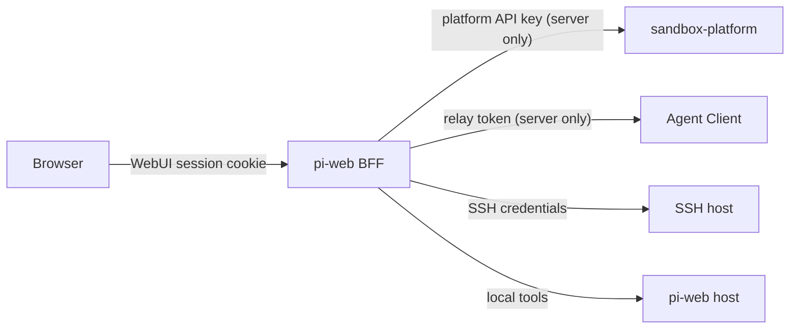

# 安全模型与信任边界

> 状态：现行（2026-11-23）。本文是框架级安全总览；专题细节见
> [path-policy-guardrails.md](./path-policy-guardrails.md)、
> [tool-guardrails-design.md](./tool-guardrails-design.md)、
> [commercial-protection.md](./commercial-protection.md)。

## 1. 边界总览

- 浏览器只持有 WebUI 会话 cookie；平台 API key、Agent token、SSH 凭据只在服务端。
- 所有远程面板（文件、终端、Plan、MCP）都按会话 descriptor 路由，浏览器不能指定
  执行面或容器 id 来绕过。
- 控制面（pi-web）与执行面（容器/用户机器/SSH/服务器本地）分离；控制面失陷不等同于
  执行面权限，但 Host 模式本身就是高权限执行面。

## 2. Web 认证与授权

- 登录：`/api/webauth/login` 代理平台登录，建立 HttpOnly cookie；`PI_WEB_AUTH=off`
  是单用户兼容模式。
- 角色：平台 `user` / `admin`；Host 项目/会话仅管理员。
- 会话：7 天滑动 + 90 天绝对上限；管理员禁用/改角色/重置密码后本地会话立即失效。
- CSRF/同源：写 API 检查可信 Origin/Host 与 JSON Content-Type；Cookie SameSite=Lax，
  HTTPS 部署可加 Secure。
- 越权响应统一 404，不泄露资源存在性；管理员支持视图明确标记归属。

## 3. 会话归属与路径围栏

- 会话文件按用户分片；读取路径必须落在当前空间或已授权 Host 空间。
- 运行时 registry 命中也要做 owner 检查；`session-metas` 只能补充归属，不能覆盖
  访问围栏。
- fork/branch/clone/subagent 继承 owner/project/descriptor；子会话不因父会话有权限
  就自动获得跨用户访问。
- 管理员可查看他人会话用于支持；普通用户不可。

## 4. 工具执行面

### sandbox

- 工具请求带项目级平台 API key + containerId，只进绑定容器。
- 平台按 owner 隔离容器/workspace/快照；跨用户 404。
- `disableLocalFallback` 强制开启，容器/平台不可用时失败，不回落到 pi-web 本地。

### local-machine

- Agent 侧 workspace root + 每请求 `base`；`..`/symlink 逃逸拒绝。
- 旧 Agent 只允许共享根内路径；服务端给出升级/改根提示，不静默换目录。
- Agent 环境变量白名单：MCP host 不透传 `PI_*`/relay token。
- 路径护栏批准可放宽单次 relay 围栏（`cwd+tool+raw path` 标记），只对已批准路径生效。

### SSH

- 凭据存项目 `.pi/ssh.json`（0600），不进配置包/日志。
- 工具/SFTP/PTY 都在远端 workdir 围栏内；会话 cwd 仍是服务器 home。
- SSH 主机权限是最终边界；平台不假设远端有容器隔离。

### Host

- 仅管理员可创建 Host 项目/会话。
- 外部目录不复制、不删除；项目配置写入受项目写锁。
- 普通用户请求 Host 本地文件/终端 API 被拒绝（空 roots）。

## 5. 路径护栏

路径护栏（`pi-config/agent/extensions/amedac-core/.../path-guard*`）是**行为护栏**：

- 覆盖 read/write/edit/bash/ls/find/grep 等声明工具；bash 解析支持重定向、`sed -i`、
  `dd`、`find -delete`、`cp/mv`、`cd` 等，best-effort。
- 决策顺序：自保护 → deny → 持久决策 → allow → 工作区外 ask/deny。
- 决策文件 `.pi/path-policy.decisions.json` 随项目分发包；运行时 scope 文件不导出。
- 远端模式用 `.pi/path-policy.scope.json` 把远端 workspace 映射回项目 home。
- 明确不覆盖：MCP/第三方扩展内部文件操作、解释器脚本内容、变量展开、
  构建工具间接写入、bash 读（`cat .env`）等。强隔离依赖容器/Agent/SSH。

## 6. MCP 执行面

- HTTP/SSE MCP：pi-web 发起请求，远端模式默认可用；服务端仍需自己的 token/ACL。
- stdio MCP 默认在 pi-web 控制面执行；普通用户 project/user stdio 被拒绝。
- `plane="host"` 仅管理员显式豁免，等于承认控制面执行风险。
- local-machine + project scope + `plane="workspace"`：由 Agent 0.8+ 在用户机器执行；
  必须 `lifecycle=lazy`（或 lazy-keep-alive）+ `directTools=false`，防止 adapter
  在控制面启动连接；创建/导入/同步/会话启动四道校验。
- MCP `_meta` 带 `amedac/session_id|user_id|user_name`；HTTP header 同理。它们不是
  授权凭据，服务端仍要校验自己的 token/ACL。
- MCP 工具未自动接入 path-guard；工作区路径边界由 MCP 服务自身负责。

## 7. 项目信任与配置包

- 项目 `.pi` 可加载扩展/技能/MCP；首次使用需要项目信任（trust.json）。
- 配置包导入：路径白名单、凭证剥离、schema 校验、stdio 闸门、zip 结构/大小限制；
  解包后先写临时目录，再原子落盘；失败不半写。
- 导出的包不含 auth/ssh/sandbox-platform 凭据、sessions/tmp/bin/cache 等运行态。
- 导入的 extension 仍会在项目会话执行；只信任来源明确的包。
- apkg 额外有客户身份、封条、许可/导入计数；边界见 commercial-protection。

## 8. 凭据与日志

- 平台 API key vault 以 0600 保存（产品取舍：服务端需要可回显/转发）；浏览器不接触。
- 用户级 models/auth 文件 0600；项目凭据文件 0600。
- 服务端日志只记录 warn/error/结构化事件；不记录完整请求体、密钥、SSH 私钥。
- Agent/平台错误回传会脱敏；诊断需要时由管理员在受控环境复现。

## 9. 批量、嵌入与分享

- 批量任务按 owner 隔离；每用户并发限流；host 模式仅管理员，local-machine 需配对。
- 嵌入页使用固定项目 + 用户 API Key 换短期 `emba_` token；CORS/项目围栏独立校验。
- 分享链接 token 只存 sha256，可设 TTL/下载次数；Host 活引用重新做路径围栏，
  远程模式使用快照，不依赖原会话凭据。

## 10. 已知残余风险

- 单进程事件循环：恶意超大 JSON/会话可造成恢复阻塞；有大小/并发/内存守卫，但不是
  CPU 隔离。
- Agent Client 运行在用户机器，用户对该机器有完全权限；平台只做应用层围栏。
- Windows PTY 桩、旧 Agent 不支持 workspace base/MCP host 时功能降级。
- 平台账号在 pi-web 之外被删除/禁用时，本地会话失效依赖管理端触发或 401 复查。
- 路径护栏与 MCP 声明不是安全边界；不要把不可信代码放进 Host/控制面执行。
